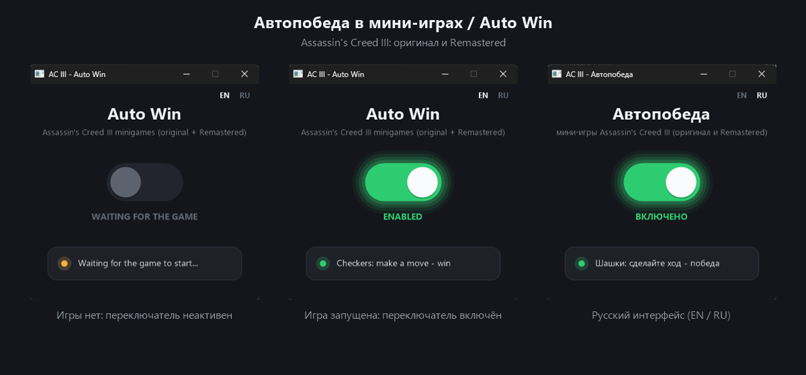

# AC III Auto Win

Download: [Releases](../../releases/latest)

## English

One switch that wins the minigames of **Assassin's Creed III** (single-player only): **Checkers, Fanorona, Nine Men's Morris and Bowls.**
Works with the original game (`AC3SP.exe`, build of 2013-07-15) and with Assassin's Creed III Remastered (`ACIII.exe`), any store edition of a supported build.

**How to use**
1. Run `Ac3AutoWin.exe` (it asks for administrator rights).
2. Start the game. The switch becomes active once a game is running.
3. Turn the switch on, start a minigame and make one move (Bowls: one throw): you win.
4. Close the game: the switch turns itself off. Closing the window removes every patch.

**Requirements**
- Windows Vista SP2 – 11, 32- or 64-bit (Remastered exists for 64-bit only). Nothing to install.
- Administrator rights.
- Only known game builds are supported; on any other build nothing is changed.

**Notes**
- No game files are modified: the win check is patched in the game's memory only and restored afterwards.
- Single-player only. Do not use online.
- Antivirus programs may complain: like any trainer, the program writes to another process's memory, and on 64-bit Windows the exe unpacks its 64-bit part to `%TEMP%\Ac3AutoWin`. Detections are heuristic.
- VirusTotal: https://www.virustotal.com/gui/file/14b1e5bb577a732743fbc902e068f1d47bf917f485d4464489b2b991b52079a4
- SHA-256 `Ac3AutoWin.exe`: `14b1e5bb577a732743fbc902e068f1d47bf917f485d4464489b2b991b52079a4`
- Tested on Windows 11. Reports from older systems are welcome in Issues.

## Русский

Один переключатель, который выигрывает мини-игры **Assassin's Creed III** (только одиночная игра): **Шашки, Фанорона, Мельница и Боулз.**
Работает с оригиналом (`AC3SP.exe` от 15.07.2013) и с Assassin's Creed III Remastered (`ACIII.exe`), любое издание известной сборки.

**Как пользоваться**
1. Запустите `Ac3AutoWin.exe` (попросит права администратора).
2. Запустите игру. Переключатель станет активным, когда игра запущена.
3. Включите переключатель, начните мини-игру и сделайте один ход (в Боулз один бросок): победа ваша.
4. Закройте игру: переключатель выключится сам. Закрытие окна снимает все изменения.

**Требования**
- Windows Vista SP2 – 11, 32 или 64 бит (Remastered только на 64-битной). Ничего устанавливать не нужно.
- Права администратора.
- Поддерживаются только известные сборки; на другой сборке программа ничего не меняет.

**Примечания**
- Файлы игры не изменяются: проверка победы правится только в памяти и возвращается обратно.
- Только для одиночной игры. Онлайн не используйте.
- Антивирус может ругаться: как любой трейнер, программа пишет в память другого процесса, а на 64-битной Windows распаковывает 64-битную часть в `%TEMP%\Ac3AutoWin`. Срабатывания эвристические.
- VirusTotal: ссылка выше. SHA-256 `Ac3AutoWin.exe` указан выше.

